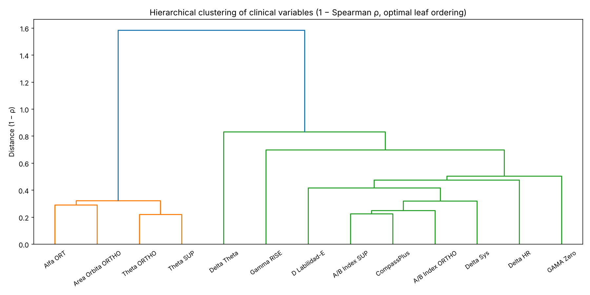
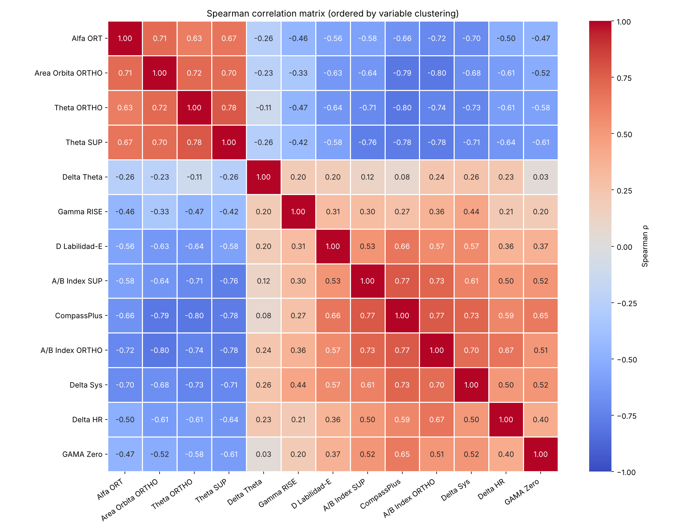
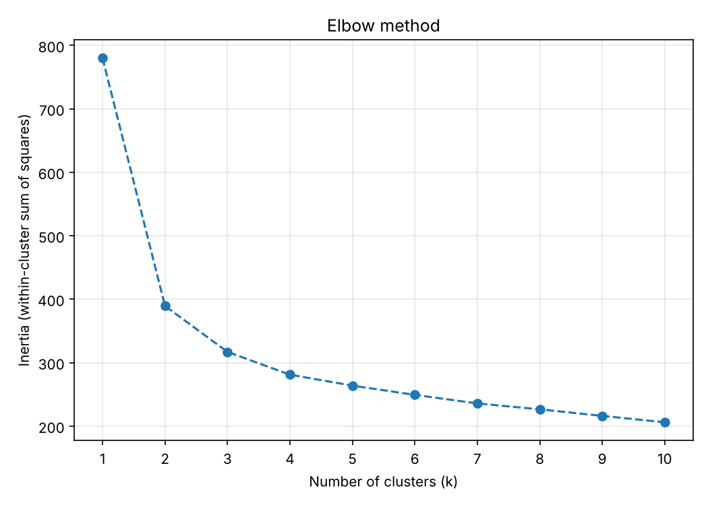
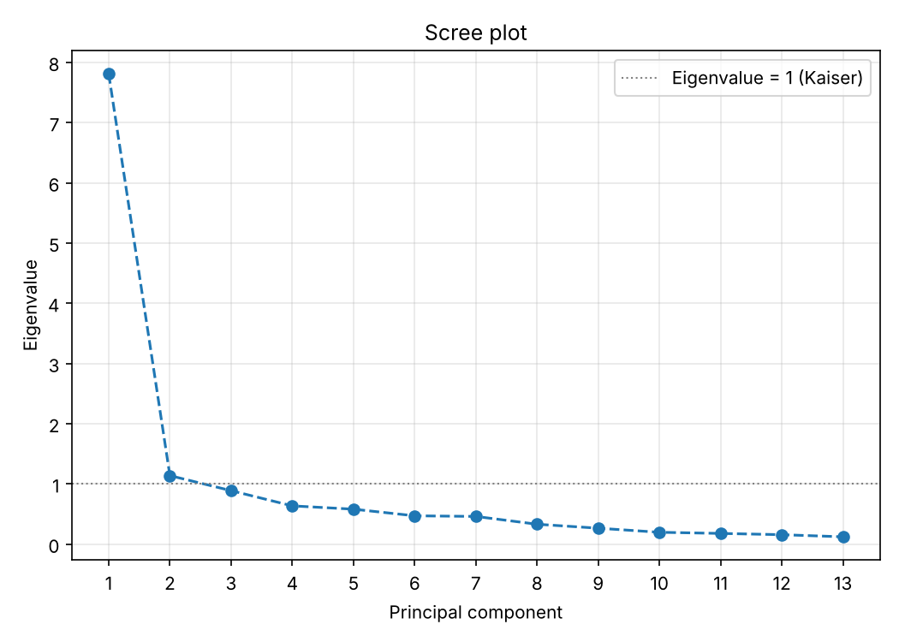
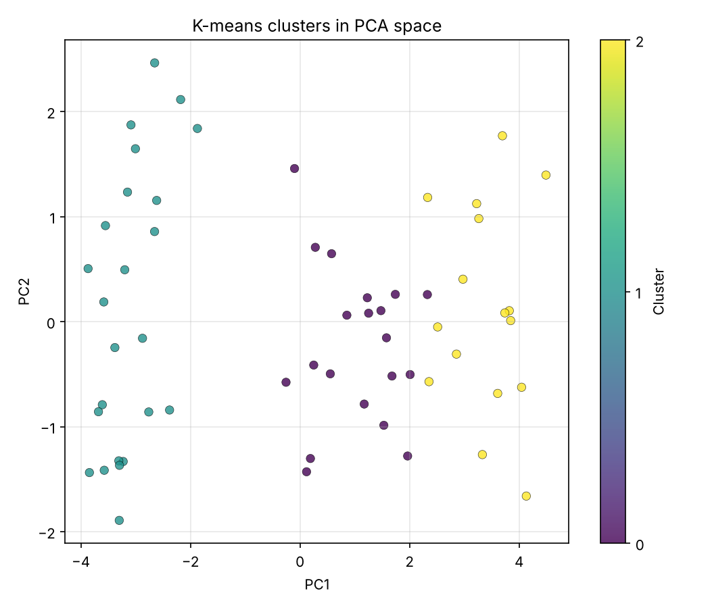
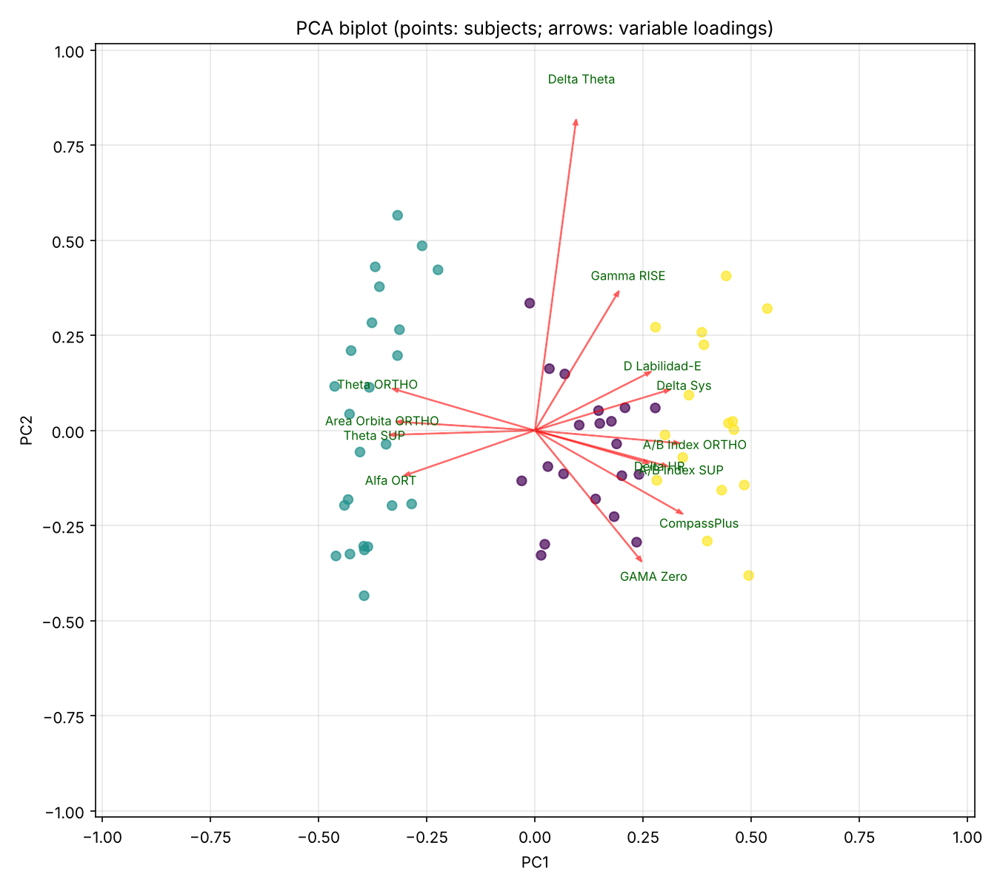

# Unsupervised Phenotyping of POTS-like Autonomic Dysfunction

An unsupervised machine-learning pipeline to explore whether patients with postural orthostatic tachycardia syndrome (POTS)-like symptoms after COVID-19 group into distinct autonomic phenotypes, using hemodynamic and baroreflex variables from active stand tests.

> **Context:** Exploratory analysis from a research internship (January–July 2025) at the Neuroinflammation and Dysautonomia Laboratory, Department of Neurology and Psychiatry, Instituto Nacional de Ciencias Médicas y Nutrición Salvador Zubirán (INCMNSZ), Mexico City, supervised by José de Jesús Aceves-Buendía, PhD.
>
> **No patient data is included.** The original dataset is confidential. This repository runs on a **synthetic dataset** with the same variables, and every figure shown here was generated from that synthetic data.

---

## Motivation

POTS is traditionally defined by an excessive heart-rate rise on standing, and is usually split into subtypes (neuropathic, hyperadrenergic, hypovolemic). Many Long-COVID patients with orthostatic intolerance don't fit those categories cleanly. The aim was to let the data suggest groups, rather than imposing predefined subtypes, by clustering patients on autonomic variables measured with a Finapres device during an active stand test.

## Pipeline

| Step | Method | Output |
|---|---|---|
| 1. Variable relationships | Spearman rank correlation (robust to non-normal, small-sample data) | Correlation matrix |
| 2. Variable structure | Average-linkage hierarchical clustering on the 1 − ρ distance, with optimal leaf ordering | Dendrogram and reordered heatmap |
| 3. Number of clusters | Standardization, elbow method (k = 1–10) | Elbow plot |
| 4. Dimensionality reduction | Principal component analysis; 4 components kept | Scree plot, cumulative variance, loadings |
| 5. Clustering | K-means in PCA space; k = 3 to 6 compared (silhouette score) | Cluster assignments, comparison table |
| 6. Interpretation | Cluster scatter plot and PCA biplot | Which variables drive each cluster |
| 7. Alternative explored | Gaussian Mixture Model, on raw variables or PCA components | Probabilistic cluster membership |

## Variables

The 13 variables of the original analysis come from the active stand test (supine, then standing) and a symptom questionnaire. Many are outputs of the lab's autonomic analysis software, including the geometric baroreflex-sensitivity method published in [Sáinz-Jiménez, Romero Fragoso et al., 2026](https://doi.org/10.3389/fcvm.2026.1830347).

| Variable | Description |
|---|---|
| Theta SUP, Theta ORTHO | Baroreflex sensitivity angle θ (confidence-ellipse method), supine and orthostatic |
| Delta Theta | Change in θ from supine to standing |
| Area Orbita ORTHO | Area of the ΔSBP–ΔIBI confidence ellipse, orthostatic **[TODO: confirm]** |
| A/B Index SUP, A/B Index ORTHO | Ellipse axis ratio (shape of the ΔSBP–ΔIBI cloud), supine and orthostatic **[TODO: confirm]** |
| Delta Sys, Delta HR | Change in systolic blood pressure and heart rate on standing |
| Gamma RISE | Kinetics of the blood-pressure rise after standing (sigmoid fit) |
| GAMA Zero | **[TODO: short description]** |
| Alfa ORT | **[TODO: short description]** |
| D Labilidad-E | **[TODO: short description]** |
| CompassPlus | COMPASS-31+ autonomic symptom score |

## Results

### Original exploratory study (data not included)
- **Cohort:** 23 subjects with Finapres active stand recordings, from healthy controls to patients with significant comorbidities; 13 variables per subject
- Spearman correlation and hierarchical clustering revealed groups of related variables, which guided feature interpretation
- K-means with 3 to 6 clusters was tested on 4 principal components. **The 3-cluster solution performed best: it grouped all healthy controls into a single cluster**
- With 23 subjects the analysis is exploratory. The pipeline was left ready to run again once the cohort exceeds 60 patients

### Demonstration on synthetic data
Running the pipeline on 60 simulated subjects (3 latent groups) recovers the simulated structure: with k = 3, all controls fall into one cluster, and agreement with the simulated groups is high (adjusted Rand index ≈ 0.91). These numbers only show that the pipeline works as intended. **They are not clinical results.**

| Variable structure | Correlation matrix |
|---|---|
|  |  |

| Elbow method | Scree plot |
|---|---|
|  |  |

| K-means clusters (PCA space) | PCA biplot |
|---|---|
|  |  |

## Usage

```bash
pip install -r requirements.txt

# 1. Generate synthetic data (60 subjects)
python src/synthetic_data.py --n 60 --out data/synthetic_dataset.csv

# 2. Main pipeline: figures go to figures/, tables to results/
python src/main_pipeline.py --data data/synthetic_dataset.csv --n-components 4 --k 3

# 3. Alternative: Gaussian Mixture Model
python src/gmm_exploration.py --data data/synthetic_dataset.csv               # 4 standardized variables
python src/gmm_exploration.py --data data/synthetic_dataset.csv --use-pca     # on PCA components
```

To use your own data, provide a CSV with one row per subject and one column per variable (an optional `id` column is ignored).

## Repository structure

```
├── src/
│   ├── main_pipeline.py      # correlation, variable clustering, PCA, k-means, figures
│   ├── gmm_exploration.py    # Gaussian Mixture Model alternative
│   └── synthetic_data.py     # synthetic dataset generator (no patient data)
├── data/                     # synthetic_dataset.csv only
├── figures/                  # generated figures
├── results/                  # generated tables (assignments, loadings, k comparison)
└── requirements.txt
```

## Notes on this version

This repository is a cleaned-up version (2026) of the original internship scripts (2025). The analysis is the same; the changes are:
- Hard-coded file paths replaced by command-line options
- Variable clustering now passes a condensed distance matrix (`squareform`) to `linkage`, so the dendrogram reflects 1 − ρ distances as intended
- The correlation heatmap is ordered by the same hierarchical clustering as the dendrogram (the original also experimented with a Monte Carlo reordering)
- Silhouette scores added to the k = 3–6 comparison
- Outputs saved as separate, tidy tables instead of one combined file
- The two Gaussian Mixture Model experiments merged into one script

## Author

**Ignacio Romero Fragoso**, Biomedical Systems Engineer, UNAM.
Research internship at INCMNSZ under the supervision of José de Jesús Aceves-Buendía, PhD.
